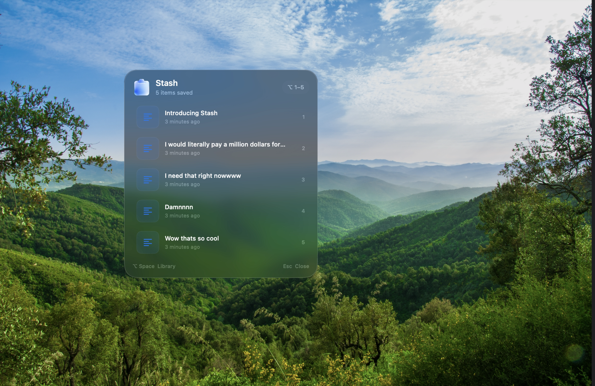

# Stash

Stash is a lightweight clipboard manager for macOS. It lives in the menu bar and keeps recent text and images close at hand.



## Download and install

**Stash currently has no prebuilt `.app` download.** The GitHub release and ZIP downloads contain source code; build the app on your Mac using the steps below. This requires an Apple Silicon Mac running macOS 15 or later, and Swift 6.3 or later (included with Xcode 26.4 or later).

### Option 1: Clone with Git

1. Install Xcode 26.4 or later, or the matching Command Line Tools (Apple Terminal, VS Code Terminal, etc.)
2. Open Terminal and run:

   ```sh
   git clone https://github.com/harry12132/stash.git
   cd stash
   ./build-app.sh
   mkdir -p ~/Applications
   ditto Stash.app ~/Applications/Stash.app
   open ~/Applications/Stash.app
   ```

### Option 2: Download the source ZIP

1. Download the [latest source ZIP](https://github.com/harry12132/stash/archive/refs/heads/main.zip), or choose **Code → Download ZIP** on the [repository page](https://github.com/harry12132/stash).
2. Unzip it and open Terminal in the extracted `stash-main` folder.
3. Run:

   ```sh
   ./build-app.sh
   mkdir -p ~/Applications
   ditto Stash.app ~/Applications/Stash.app
   open ~/Applications/Stash.app
   ```

You can also find the [latest GitHub release](https://github.com/harry12132/stash/releases/latest). Releases currently provide source, not a prebuilt app. These steps install Stash in your personal Applications folder and do not require an administrator password.

## Features

- Show a floating HUD with recent clipboard items.
- Keep a local history of copied text and images.
- Search clipboard history; preview, pin, unpin, copy, and delete items.
- Pause clipboard monitoring.
- Choose whether history is saved between launches and set the maximum number of unpinned items.
- Exclude applications from clipboard capture by bundle identifier.
- Launch at login.
- Optionally colour your Zsh prompt's device name and directory, and the command as you type.

## Shortcuts

| Shortcut | Action |
| --- | --- |
| Hold **Option (⌥)** | Show the floating clipboard HUD |
| **Option–1** to **Option–5** | Paste one of the five most recent visible items |
| **Option–Space** | Open the clipboard library |
| **Escape** or release **Option (⌥)** | Dismiss the HUD |

You can also open Stash from its menu-bar icon. Choose **Show Clipboard HUD** if the HUD shortcut is unavailable, or **Open Stash** to browse the full library.

## Settings and permissions

Open **Settings…** from the Stash menu-bar menu.

- **Clipboard:** Pause monitoring, enable or disable saving history between launches, and set the maximum number of unpinned items.
- **Privacy:** Enter one excluded application's bundle identifier per line, save the list, or clear clipboard history.
- **General:** Enable or disable launch at login.
- **Terminal:** Choose prompt and command colors, and install or remove the optional Zsh integration.

macOS controls keyboard and paste permissions. If shortcuts or automatic pasting do not work, open **System Settings → Privacy & Security** and allow Stash under **Input Monitoring** and, if requested, **Accessibility** (the exact labels can vary by macOS version). Quit and reopen Stash after changing permissions.

## Zsh colors

In **Settings → Terminal**, choose a color for **Device name + directory** and a separate color for **Command text**, then select **Install Zsh integration**. Stash adds a managed hook to `~/.zshrc` and writes its script to `~/.config/stash/terminal-integration.zsh`. Open a new Zsh terminal for the changes to take effect. Remove the integration from Settings at any time.

The prompt color is applied to standard Zsh hostname and directory prompt escapes. Custom prompts that construct these values in another way may not be recolored. Stash does not capture terminal output or add terminal copy controls.

## Updating

For a Git clone, open Terminal in the repository and run:

```sh
git pull
./build-app.sh
ditto Stash.app ~/Applications/Stash.app
```

For a source ZIP installation, download and extract the latest ZIP, then run the build and install commands from the new folder.

## Privacy

Clipboard history is stored locally on your Mac and is not encrypted. Stash does not transmit clipboard data to a remote service. Pause monitoring before copying sensitive content, exclude applications as needed, and clear history when it is no longer needed. Images in saved history are stored under `~/Library/Application Support/Stash`.

## Uninstall

1. Choose **Remove Zsh integration** in Stash Settings if you enabled it.
2. Quit Stash from its menu-bar menu.
3. Turn off **Launch at login** in Settings if it is enabled.
4. Move `~/Applications/Stash.app` to the Trash.
5. To delete saved clipboard history and preferences, move `~/Library/Application Support/Stash` to the Trash.

## Build from source

To run the executable directly:

```sh
swift build -c release
swift run
```

To create the standalone app bundle:

```sh
./build-app.sh
```

Stash uses SwiftUI and AppKit with Swift Package Manager. The app bundle is ad-hoc signed for local development and is not notarized for direct binary distribution.

## License

Stash is licensed under the MIT License. See [LICENSE](LICENSE).
